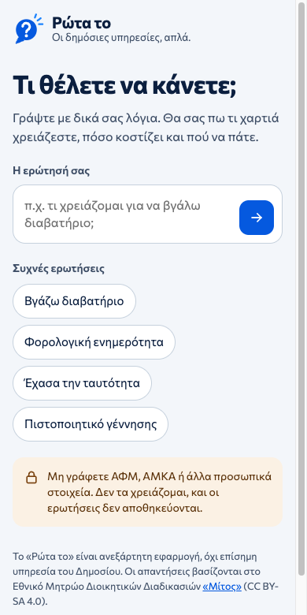
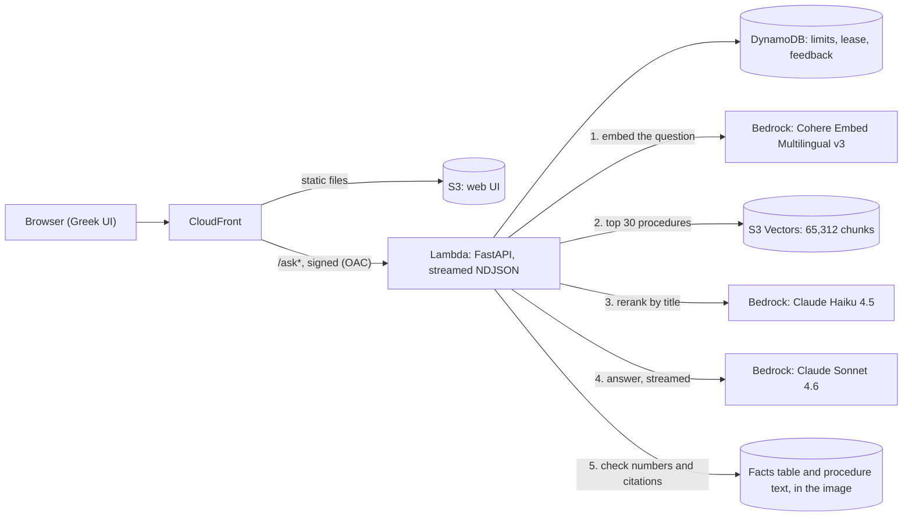

# Ρώτα το

**Ask about a Greek public service in everyday Greek, and get a grounded answer with the official source.**

**Live demo: [rotato.pantelis-tsagkas.com](https://rotato.pantelis-tsagkas.com)** (an independent demo, not an official government service; 15 questions a day for the whole site)

**Status: ACTIVE.** Deployed on AWS. Retrieval, answers and the answer checker are evaluated on a held-out test set, and the known weak spots are listed under [Limitations](#limitations).



## The problem

People know their situation, not the official name of the procedure. They ask "έχασα την ταυτότητά μου, τι κάνω;" or "πόσο κοστίζει το διαβατήριο για παιδί;". The national registry [Μίτος](https://mitos.gov.gr) describes 4,406 procedures in detail, but in administrative Greek. Keyword search fails on everyday wording: BM25 found the right procedure in the top five for only half of the dev questions.

Ρώτα το maps the everyday question to the right procedure and answers only from that procedure's text and structured facts. Every answer links the official Mitos page and credits Mitos.

## How it works



1. **Retrieve.** The question is embedded with Cohere Embed Multilingual v3 and searched in Amazon S3 Vectors. Dense retrieval beat BM25 by a wide margin on everyday Greek ([002](docs/decisions/002-bm25-baseline.md), [003](docs/decisions/003-greek-stemming.md), [004](docs/decisions/004-dense-retrieval-cohere.md), [005](docs/decisions/005-vector-store-s3-vectors.md)).
2. **Rerank.** Claude Haiku 4.5 reranks the top 30 procedures by title and alternative titles. Misses were a ranking problem, not a chunking one: on dev the right procedure was always in the top 20 ([008](docs/decisions/008-rerank.md), [009](docs/decisions/009-rerank-in-the-pipeline.md)).
3. **Answer.** Claude Sonnet 4.6 answers in Greek with structured output and one of three statuses: answered, ambiguous (with a clarifying question and options) or not found ([006](docs/decisions/006-grounded-answers-haiku.md), [007](docs/decisions/007-answer-model-sonnet-4-6.md)).
4. **Check.** Code, not the model, checks every cited procedure against the retrieved set, and every fee and duration against the structured facts table or the cited procedure's own text. Anything it cannot ground gets a visible warning ([010](docs/decisions/010-text-grounded-checker.md), [011](docs/decisions/011-facts-row-cap.md)).
5. **Show.** The UI streams the answer, then shows the sources with fact tiles (cost, how to apply, duration, validity) built from the facts table, never from the model ([012](docs/decisions/012-streaming-and-procedure-links.md)).

The offline pipeline that builds the index: Mitos API, polite incremental download, render to Greek Markdown, structured facts with provenance, chunks of at most 1,500 characters, Cohere embeddings ($1.67 for the whole corpus), S3 Vectors.

## Results

**Held-out test set, run once and never tuned on** (10 questions; Sonnet 4.6 with the Haiku reranker):

| Measure | Result | What it means |
|---|---|---|
| Retrieval hit@5 | 0.89 (8 of 9) | A correct procedure was in the top five for 8 of the 9 questions scored for retrieval. |
| Status accuracy | 0.80 (8 of 10) | Answered, ambiguous or not found was right for 8 of 10. One asked a clarifying question instead of answering; one was a retrieval miss. |
| Invalid citations | 0 | Every cited procedure was one of the retrieved ones. This does not prove each citation was the best one. |
| Expected facts | 2 of 2 | The fees and durations the labels expected were present and correct. |
| Unsupported numbers | 0 | No fee or duration failed the checker. The checker does not read the rest of the prose. |

**What changed because of the eval** (dev set, 20 questions, used for tuning):

| Step | hit@5 | MRR | Outcome |
|---|---|---|---|
| BM25 on whole documents, no normalisation | 0.06 to 0.11 | | |
| BM25 on sections, accent folding | 0.50 | 0.43 | baseline |
| + Greek Snowball stemming | 0.33 | | rejected: everyday words merge with admin words |
| Cohere dense retrieval | 0.89 | 0.70 | adopted |
| Dense + BM25 (equal-weight RRF) | 0.78 | | rejected: BM25 drags down vocabulary-gap questions |
| + Cohere Rerank 3.5 | 0.89 | 0.76 | rejected |
| + Claude Haiku 4.5 rerank | 1.00 | 1.00 | adopted |

| Answer model (dev) | Status accuracy | Expected facts |
|---|---|---|
| Haiku 4.5, dense top 5 | 0.70 | 3 of 5 |
| Sonnet 4.6, dense top 5 | 0.80 | 4 of 5 |
| Haiku 4.5 + Haiku rerank | 0.85 | 3 of 5 |
| **Sonnet 4.6 + Haiku rerank (adopted)** | **0.95** | **5 of 5** |

The eval set is small and was written with Claude Code from the registry, not collected from real users ([eval/README.md](eval/README.md)). Treat the numbers as evidence for each decision, not as a general reliability figure.

## Production, cost and privacy

- **Serverless, all in Terraform.** Lambda (arm64 container with the Lambda Web Adapter) behind an IAM-authenticated Function URL, reached only through CloudFront with origin access control. The UI sits in a private S3 bucket. Limits, the one-at-a-time lease and feedback live in DynamoDB. An account budget alarm sits in its own Terraform root ([013](docs/decisions/013-hosting.md), [docs/well-architected.md](docs/well-architected.md)).
- **Cost.** About $0.05 per question, measured on the live site. Idle, the demo costs about $0.03 a month. The whole build, every eval run included, cost about $7.30 in AWS before tax (Cost Explorer).
- **Cost and abuse limits.** 15 questions a day for the whole site, 3 per visitor per minute, 300 characters, one question at a time. If the visitor leaves, the model calls that have not started are skipped.
- **Latency.** First answer text after about 5 s, the full answer after 16 to 19 s (Sonnet writes about 55 to 70 tokens a second), measured on single questions. A cold start adds about 6 s.
- **Privacy by design.** Questions are not stored or logged anywhere: logs carry status, cost and timings only. The models run through Amazon Bedrock in EU regions, with model invocation logging off; AWS does not use the content for training or share it with the model providers. The visitor's IP is kept only as a hash for a couple of minutes, for the rate limit. Feedback keeps a yes or no and a fixed reason, without the question ([014](docs/decisions/014-answer-feedback.md)).

## Limitations

- **Questions that need several procedures.** "Πέθανε ο πατέρας μου, τι χαρτιά χρειάζομαι;" involves several procedures, and retrieval tends to find one plausible match rather than all of them. On dev, 1 of the 2 multi-procedure questions cited every expected procedure; the test question of this kind was a retrieval miss. Splitting such questions into parts before retrieval is the next step.
- **The checker sees numbers and citations, not omissions or prose.** An asylum legal-aid answer was accurate but left out the identity document and the main precondition, and nothing flagged it. In an early run the model wrote, wrongly, that passports are applied for at a ΚΕΠ.
- **The data is a snapshot.** It dates from 2026-10-14 and is refreshed by hand. A check on 2026-10-25 found 9 new procedures and about 85 real edits since, plus a bulk formatting change by the registry. A scheduled refresh is planned.
- **Demo-grade operations.** One question at a time, a Bedrock quota of 10 requests a minute, no WAF and no CI/CD pipeline yet.

## Decision records

Every choice was measured before it was adopted. The records in [docs/decisions/](docs/decisions/) keep the numbers, the options that lost, and the cost of each experiment.

| # | Question | Outcome |
|---|---|---|
| [001](docs/decisions/001-corpus-profile.md) | What does the corpus look like? | 4,406 procedures, p50 2,594 tokens; renderer fixes |
| [002](docs/decisions/002-bm25-baseline.md) | How far does keyword search get? | BM25 baseline, hit@5 0.50 |
| [003](docs/decisions/003-greek-stemming.md) | Does Greek stemming help? | No, 0.50 to 0.33 |
| [004](docs/decisions/004-dense-retrieval-cohere.md) | Which embeddings? | Cohere Multilingual v3, dense only |
| [005](docs/decisions/005-vector-store-s3-vectors.md) | Which vector store? | Amazon S3 Vectors |
| [006](docs/decisions/006-grounded-answers-haiku.md) | Grounded answers and the checker | Structured output, code validation |
| [007](docs/decisions/007-answer-model-sonnet-4-6.md) | Is a stronger model worth it? | Sonnet 4.6 A/B |
| [008](docs/decisions/008-rerank.md) | Why are the right procedures ranked low? | Ranking, not chunking; Haiku reranker |
| [009](docs/decisions/009-rerank-in-the-pipeline.md) | Rerank in the answer pipeline | Sonnet 4.6 + Haiku rerank adopted |
| [010](docs/decisions/010-text-grounded-checker.md) | Numbers the facts table lacks | Grounded in the procedure's own text |
| [011](docs/decisions/011-facts-row-cap.md) | Huge facts rows | Capped at 6,000 characters |
| [012](docs/decisions/012-streaming-and-procedure-links.md) | Streaming and source links | NDJSON streaming, Mitos page links |
| [013](docs/decisions/013-hosting.md) | How to host it | Lambda + CloudFront, about $0.03 a month idle |
| [014](docs/decisions/014-answer-feedback.md) | Answer feedback | Yes or no with fixed reasons, no free text |

## Reproduce it

To use the assistant, open the [live demo](https://rotato.pantelis-tsagkas.com): nothing to install. This section is for anyone who wants to check the results, rerun the evals or adapt the pipeline to another corpus. The Python package and its commands keep the project's working name, `mitos-rag`.

### Free, no AWS account

Python 3.12+ and [uv](https://docs.astral.sh/uv/). The tests make no network calls, and the Mitos API needs no key.

```bash
uv sync
uv run pytest

# Download 20 procedures to try it out (no key needed; the client is polite and incremental)
uv run mitos-download --out data/raw --max-services 20

# Turn them into clean Markdown documents and structured facts
uv run mitos-render --raw data/raw --out data/docs
uv run mitos-facts --raw data/raw --out data/facts/facts.jsonl

# Retrieval eval on the dev questions (needs the full download and render)
uv run mitos-eval --split dev
```

Downloading all 4,406 procedures takes 30 to 45 minutes with the default delay. Re-runs fetch only procedures whose `last_updated` changed.

### With AWS (paid)

Dense retrieval, reranking, answers and the API need an AWS account, credentials, Terraform and Amazon Bedrock in eu-central-1. Two things to expect on a new account: the first call to each model creates an AWS Marketplace subscription, and the Bedrock quotas for the Claude models can start at 0, so the calls fail until a Service Quotas increase is granted, which can take days ([006](docs/decisions/006-grounded-answers-haiku.md), [007](docs/decisions/007-answer-model-sonnet-4-6.md)). Prices are in the decision records:

```bash
uv run mitos-embed --model cohere                       # Bedrock embeddings, about $1.70 for the corpus
(cd terraform/project && terraform init && terraform apply)   # vector bucket and index
uv run mitos-index --bucket mitos-rag-vectors --index chunks-cohere-v3-20261014 --resume
uv run mitos-eval --split dev --dense cohere --vector-index mitos-rag-vectors/chunks-cohere-v3-20261014

# Ask a question: Haiku 4.5 reranks, Sonnet 4.6 answers (about $0.05 per new question)
uv run mitos-ask "ποσο κοστιζει διαβατηριο για παιδι 10 χρονων"
uv run mitos-ask --model haiku-4.5 "..."     # Haiku answers, about $0.018
uv run mitos-ask --rerank none "..."         # the dense top 5, as in 006 and 007

# HTTP API and Greek UI: one worker, no question storage, per-IP and daily limits
uv run mitos-api                             # open http://127.0.0.1:8000

# Answer eval: quote the cost first (free), then run it
uv run mitos-answer-eval --split dev --dry-run
uv run mitos-answer-eval --split dev
```

### Deploy the demo

The demo runs the same API on Lambda behind CloudFront. It needs Docker and the full download and render (the image carries `data/docs` and the facts table):

```bash
cd terraform/app
terraform init
terraform apply -target=aws_ecr_repository.api -target=aws_ecr_lifecycle_policy.api
../../scripts/push-image.sh                    # builds the arm64 image, pushes it, prints the tag
terraform apply -var image_tag=<tag> -var domain_name=<your domain> -var custom_domain_ready=false
```

A custom domain needs its ACM validation record at your DNS provider first (output `acm_validation_records`); then apply again without `custom_domain_ready=false`. `terraform destroy` removes all of it.

## Layout

```
src/mitos_rag/
  client.py       typed client for the Mitos API (pagination, retries, backoff)
  download.py     saves raw JSON, incremental
  render.py       raw JSON -> one Greek Markdown document per procedure
  facts.py        raw JSON -> structured facts (costs, deadlines, online or not) with provenance
  text.py         Greek tokeniser (casefold, accent folding, optional Snowball stemming)
  bm25.py         Okapi BM25
  corpus.py       rendered docs -> retrieval units (whole doc or section)
  chunk.py        sections -> chunks of at most 1,500 characters, with title prefix
  embed.py        mitos-embed: Bedrock embeddings with a resumable cache
  dense.py        exact cosine search and reciprocal rank fusion
  vectorstore.py  mitos-index: upload to S3 Vectors, and approximate search over it
  rerank.py       mitos-rerank-eval: Haiku reranks the dense candidates by title
  pacing.py       shared pacer for the Bedrock request quota
  answer.py       mitos-ask: evidence, structured answer from Claude, sources and attribution
  api.py          mitos-api: FastAPI /ask and /ask/stream with limits and Greek errors; serves web/
  dynamo.py       limits and the one-at-a-time lease in DynamoDB, for Lambda
  validate.py     code checks on citations, typed facts, amounts and durations
  answer_eval.py  mitos-answer-eval: status, citations, facts, cost and latency
  evaluate.py     mitos-eval: hit@k, MRR, recall@k on eval/
web/              mobile-first Greek UI: static HTML, CSS and JS over /ask/stream, no build step
eval/             dev and held-out test questions
tests/            pytest, no real network calls (httpx.MockTransport, botocore Stubber)
docs/             PRD, decision records, Well-Architected notes
terraform/        account (budget), project (S3 Vectors), app (the demo)
```

## Licence and credits

The application code is under the [MIT licence](LICENSE). The procedure data comes from the Εθνικό Μητρώο Διοικητικών Διαδικασιών «Μίτος» (mitos.gov.gr) under [CC BY-SA 4.0](https://creativecommons.org/licenses/by-sa/4.0/): any published copy of the processed data must keep the attribution and the same licence. The Commissioner font is under the SIL Open Font License ([web/fonts/OFL.txt](web/fonts/OFL.txt)). The Ρώτα το name and logo are not covered by the MIT licence.

Built by Pantelis Tsagkas · [pantelis-tsagkas.com](https://pantelis-tsagkas.com)
